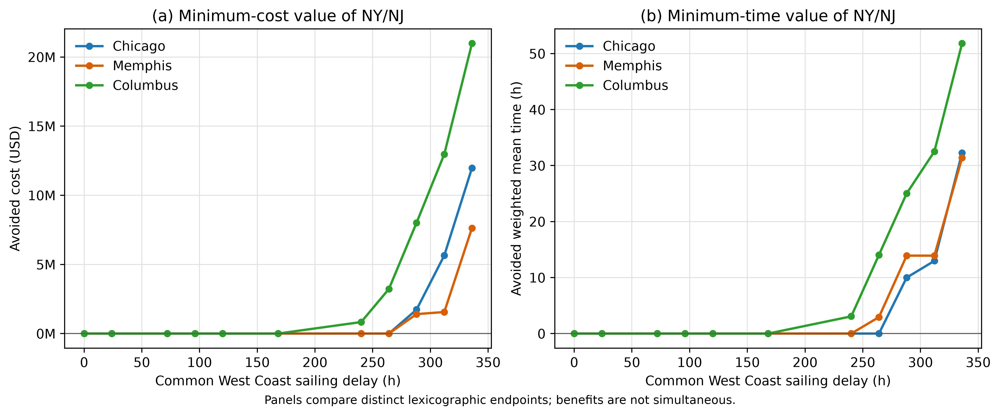

# 7. Results

## 7.1 Exact-solution coverage and candidate-path sensitivity

The final results use the enlarged candidate-path library with up to eight paths per gateway and shipment. The four-path library was nested within the enlarged library, but the enlargement added 160 Seattle/Tacoma alternatives to every destination--access combination: the NY/NJ-allowed models increased from 480 to 640 candidate paths, and the restricted models from 320 to 480. This was a consequential rather than cosmetic sensitivity check. The four-path formulation had suggested NY/NJ use for Memphis at 264 h and for the Chicago and Memphis compound disruptions; none of these findings remained in the enlarged model. It had also made the Columbus 240 h endpoints appear coincident, whereas the enlarged model revealed a cost--time conflict. All substantive results below therefore use the eight-path library. The four-path results are retained only to document why the smaller library was rejected as the evidentiary model.

The core exact experiment comprised 45 destination--condition combinations, each solved with and without NY/NJ access at two lexicographic endpoints. All 180 endpoint models were feasible, evaluator-consistent, and lexicographically proven; all 360 MILP calls terminated as optimal within tolerance. The largest recorded relative gap was \(9.88\times10^{-9}\). Minimum and maximum NY/NJ shares were also proven for all 88 distinct endpoint regions. The demand-instance experiment added 320 proven endpoints and 640 successful MILP calls, and the targeted capacity experiment added 32 proven endpoints and 64 successful calls. Consequently, the gateway-use and counterfactual-value results reported below do not depend on stochastic NSGA-II convergence. Exactness remains conditional on the generated candidate-path library rather than on every path that could exist in the unrestricted transport network.

Table 2 reports the two exact baseline endpoints. NY/NJ was absent from every endpoint-equivalent allocation: the proven minimum and maximum share were both zero. The baseline results therefore establish a West Coast-supported reference structure, while also showing a substantial cost--time trade-off between the two lexicographic endpoints.

Table 2. Exact baseline endpoints under the eight-path candidate library.

| Destination | Endpoint | Total cost (USD million) | Weighted mean delivery time (h) | NY/NJ share (%) |
| --- | --- | ---: | ---: | ---: |
| Chicago | Minimum cost, then time | 22.916 | 678.407 | 0 |
| Chicago | Minimum time, then cost | 29.886 | 602.296 | 0 |
| Memphis | Minimum cost, then time | 23.189 | 688.727 | 0 |
| Memphis | Minimum time, then cost | 29.390 | 600.282 | 0 |
| Columbus | Minimum cost, then time | 24.306 | 703.163 | 0 |
| Columbus | Minimum time, then cost | 31.558 | 609.177 | 0 |

## 7.2 Capacity reductions were absorbed within the West Coast path set

Reducing common West Coast node capacity to 60%, 40%, or 35% did not induce NY/NJ use at either exact endpoint for any destination. Allowing NY/NJ consequently produced no material improvement in minimum cost or minimum delivery time under these capacity-only conditions. This was not simply a result of unused West Coast capacity. Table 3 reports the highest Los Angeles/Long Beach or Seattle/Tacoma node-day utilization at each allowed endpoint. At 40% remaining capacity, every minimum-time solution reached a binding West Coast node-day. At 35%, both Memphis and Columbus reached binding node-days at both endpoints, while Chicago reached 95.24% at the minimum-cost endpoint and 100% at the minimum-time endpoint. The tested capacity reductions were therefore accommodated by changing allocations and service timing within the West Coast path set, even when specific node-day resources were binding.

Table 3. Maximum West Coast node-day utilization at exact capacity-only endpoints (%).

| Destination | Endpoint | 60% capacity | 40% capacity | 35% capacity |
| --- | --- | ---: | ---: | ---: |
| Chicago | Minimum cost, then time | 55.56 | 83.33 | 95.24 |
| Chicago | Minimum time, then cost | 83.33 | 100.00 | 100.00 |
| Memphis | Minimum cost, then time | 59.33 | 89.00 | 100.00 |
| Memphis | Minimum time, then cost | 83.33 | 100.00 | 100.00 |
| Columbus | Minimum cost, then time | 59.84 | 89.75 | 100.00 |
| Columbus | Minimum time, then cost | 83.33 | 100.00 | 100.00 |

The compound condition combining 30% remaining West Coast capacity with 168 h of delay did not materially activate NY/NJ in the enlarged model. Chicago and Memphis used no NY/NJ at either endpoint. The Columbus minimum-cost endpoint used 5.36%, below the 10% material-use criterion, saving USD 20,738 but increasing weighted mean time by 3.450 h relative to its restricted counterpart; its minimum-time endpoint used none. Thus, the compound condition did not provide evidence of material alternative-gateway use for the original demand instance. Separately, the diagnostic combining 1.5 times demand with 60% West Coast capacity was proven infeasible for all three destinations. This infeasibility result identifies a boundary of the constructed network and is not treated as an activation observation.

## 7.3 Delay-induced gateway use was destination- and objective-specific

Figure 1 reports the exact value of retaining NY/NJ access over the common West Coast sailing-delay grid. Panel (a) compares minimum-cost objective values and Panel (b) compares minimum-time objective values. Each curve is formed from a separate lexicographic endpoint; the cost and time benefits must not be interpreted as jointly attained by one allocation.

Figure 1. Exact value of NY/NJ access under common West Coast sailing delay. Positive values are restricted-minus-allowed objective differences. Cost and time panels represent distinct lexicographic endpoints and do not imply simultaneous benefits in one solution.

The exact results replace the earlier, heuristic activation ordering with a more specific endpoint-based result. Chicago and Memphis used no NY/NJ through 264 h at either endpoint. At 288 h, both destinations used NY/NJ materially at both endpoints. Columbus used no NY/NJ at 168 h, but at 240 h its minimum-cost endpoint used 32.66% while its minimum-time endpoint used none. At 264 h, both Columbus endpoints used NY/NJ. Thus, the first material use occurred between 264 and 288 h for Chicago and Memphis, but between 168 and 240 h for the Columbus minimum-cost objective and between 240 and 264 h for its minimum-time objective. These are brackets on the tested grid, not empirical switching-time estimates.

Table 4 reports the decisive conditions. Positive differences are losses avoided by allowing NY/NJ. The differences within a row compare the allowed and restricted allocation selected by the same lexicographic rule. A time difference reported for a minimum-cost row is not the value of the global minimum-time objective, and vice versa.

Table 4. Exact endpoint value and NY/NJ use at decisive delay conditions.

| Destination | Delay (h) | Endpoint | NY/NJ share (%) | Cost avoided (USD million) | Time avoided (h) |
| --- | ---: | --- | ---: | ---: | ---: |
| Chicago | 264 | Minimum cost, then time | 0 | 0.000 | 0.000 |
| Chicago | 264 | Minimum time, then cost | 0 | 0.000 | 0.000 |
| Chicago | 288 | Minimum cost, then time | 64.89 | 1.732 | 5.030 |
| Chicago | 288 | Minimum time, then cost | 32.66 | 2.260 | 3.266 |
| Memphis | 264 | Minimum cost, then time | 0 | 0.000 | 0.000 |
| Memphis | 264 | Minimum time, then cost | 0 | 0.000 | 0.000 |
| Memphis | 288 | Minimum cost, then time | 32.66 | 1.401 | 13.579 |
| Memphis | 288 | Minimum time, then cost | 32.66 | 1.966 | 2.613 |
| Columbus | 168 | Minimum cost, then time | 0 | 0.000 | 0.000 |
| Columbus | 168 | Minimum time, then cost | 0 | 0.000 | 0.000 |
| Columbus | 240 | Minimum cost, then time | 32.66 | 0.827 | 2.764 |
| Columbus | 240 | Minimum time, then cost | 0 | 0.000 | 0.000 |
| Columbus | 264 | Minimum cost, then time | 56.48 | 2.960 | -1.579 |
| Columbus | 264 | Minimum time, then cost | 32.66 | 2.944 | 0.555 |

The share-bound models sharpen this interpretation. At Chicago 288 h, all allocations within the two endpoint tolerance regions used at least 32.66% NY/NJ; the minimum-cost region fixed the share at 64.89%. At Memphis 288 h, the two endpoints attained the same objective coordinates within tolerance and the endpoint-equivalent NY/NJ share was approximately 32.66%. This identifies a singleton objective point, not a unique shipment configuration. Columbus at 240 h was preference-dependent: the minimum-cost region fixed the NY/NJ share at 32.66%, whereas the minimum-time region fixed it at zero. At Columbus 264 h, the corresponding shares were 56.48% and approximately 32.66%. The exact evidence therefore supports destination- and objective-specific gateway use, rather than a single front-wide activation order.

## 7.4 The source of the counterfactual benefit differed by destination

Cost decomposition shows that the value of NY/NJ did not arise from one universal mechanism. At the minimum-cost endpoint for Chicago at 288 h, the USD 1.732 million saving comprised USD 0.564 million in transport cost, USD 0.694 million in waiting and holding cost, and USD 0.474 million in tardiness cost. For Memphis at 288 h, NY/NJ increased transport cost by USD 1.618 million but avoided USD 0.362 million in waiting and holding cost and USD 2.657 million in tardiness cost, yielding a net saving of USD 1.401 million. For Columbus at 240 h, USD 0.525 million of the USD 0.827 million saving came from reduced tardiness cost and USD 0.284 million from waiting and holding cost. Tardiness penalties were therefore important for Memphis and Columbus, but they were neither the only source of value nor uniformly dominant across destinations.

Table 5. Decomposition of exact minimum-cost savings at the first material delay conditions (USD million).

| Destination | Delay (h) | Transport | Waiting and holding | Tardiness | Total saving |
| --- | ---: | ---: | ---: | ---: | ---: |
| Chicago | 288 | +0.564 | +0.694 | +0.474 | +1.732 |
| Memphis | 288 | -1.618 | +0.362 | +2.657 | +1.401 |
| Columbus | 240 | +0.018 | +0.284 | +0.525 | +0.827 |

Shipment-matched decomposition of the minimum-time endpoints did not support the earlier hypothesis that slower NY/NJ freight was offset by large improvements for freight remaining on the West Coast. The full 3.266 h improvement for Chicago at 288 h and the full 2.613 h improvement for Memphis at 288 h were attributable, within numerical identity tolerance, to batches assigned to NY/NJ in the allowed solution. Freight remaining on the West Coast contributed zero at the reported precision. Columbus at 240 h had no minimum-time improvement and used no NY/NJ at that endpoint; at 264 h, the 0.555 h improvement was likewise attributable to the batches reassigned to NY/NJ. These are batch-matched contributions against each batch's restricted-solution mean and do not establish a unique lineage for every split FEU.

## 7.5 The repeated 727.5 FEU allocation was capacity-induced

The enlarged exact model repeatedly assigned 727.5 FEU to NY/NJ at the Memphis 288 h endpoints and at the Columbus 240 h minimum-cost endpoint. This quantity equals total demand of 2,227.5 FEU minus the 1,500 FEU/day capacity of the relevant Los Angeles/Long Beach inland arc. The NY/NJ ocean service and NY/NJ node capacity were not binding in these allocations. A targeted sensitivity varied only that destination-specific inland arc capacity while holding the path library, demand, timetable, and all other parameters fixed.

Table 6 shows the resulting minimum-cost allocations. At 50% of the original inland-arc capacity, 1,477.5 FEU was assigned to NY/NJ for both destinations; at 100%, the quantity was 727.5 FEU. Increasing the Memphis arc to 150% or 200% eliminated NY/NJ use and its counterfactual benefit. For Columbus, increasing the arc to 150% or 200% reduced NY/NJ use to 161.5 FEU, or 7.25%, below the material-use criterion. This residual Columbus allocation still reduced minimum cost by about USD 0.085 million but increased time by 3.654 h relative to the restricted minimum-cost solution. The result separates two effects: the repeated 727.5 FEU quantity was generated by the binding 1,500 FEU/day inland arc, while a smaller Columbus cost-based allocation remained after that capacity constraint was relaxed.

Table 6. Targeted sensitivity of the binding Los Angeles/Long Beach inland arc at the minimum-cost endpoint.

| Destination and delay | Inland-arc capacity (% of 1,500 FEU/day) | NY/NJ quantity (FEU) | NY/NJ share (%) | Cost avoided (USD million) | Time avoided (h) |
| --- | ---: | ---: | ---: | ---: | ---: |
| Memphis, 288 h | 50 | 1,477.5 | 66.33 | 3.717 | 16.273 |
| Memphis, 288 h | 100 | 727.5 | 32.66 | 1.401 | 13.579 |
| Memphis, 288 h | 150 | 0 | 0 | 0.000 | 0.000 |
| Memphis, 288 h | 200 | 0 | 0 | 0.000 | 0.000 |
| Columbus, 240 h | 50 | 1,477.5 | 66.33 | 1.437 | -4.744 |
| Columbus, 240 h | 100 | 727.5 | 32.66 | 0.827 | 2.764 |
| Columbus, 240 h | 150 | 161.5 | 7.25 | 0.085 | -3.654 |
| Columbus, 240 h | 200 | 161.5 | 7.25 | 0.085 | -3.654 |

The endpoint-equivalent share bounds were proven at every sensitivity level. The earlier 427.5 FEU quantity did not recur after the path library was enlarged. It is therefore treated as a consequence of the rejected four-path representation rather than as a stable network mechanism, and no additional parameter scan was conducted for it.

## 7.6 Findings were stable across constructed demand instances

Ten additional demand instances changed batch sizes and due-date structures while preserving total demand, batch count, and the release-time rule. All 320 allowed and restricted endpoint models were proven, so every instance contributed to the comparison. Table 7 summarizes the pre-specified performance and use classifications. These counts describe robustness across constructed instances and are not estimates of real-world probabilities.

Table 7. Exact robustness across ten additional demand instances.

| Destination | Condition | Performance result (instances) | Minimum-cost endpoint NY/NJ use | Minimum-time endpoint NY/NJ use | Benefit range |
| --- | --- | --- | ---: | ---: | --- |
| Chicago | 264 h delay | No material improvement (10/10) | 0/10 | 0/10 | No material cost or time benefit |
| Chicago | 288 h delay | Both attainable objective optima improved (10/10) | 10/10 | 10/10 | Cost: USD 1.715--1.770 million; time: 3.266 h |
| Chicago | 30% capacity + 168 h | No material improvement (10/10) | 0/10 | 0/10 | No material cost or time benefit |
| Memphis | 240 h delay | No material improvement (10/10) | 0/10 | 0/10 | No material cost or time benefit |
| Memphis | 264 h delay | No material improvement (10/10) | 0/10 | 0/10 | No material cost or time benefit |
| Memphis | 288 h delay | Both attainable objective optima improved (10/10) | 10/10 | 10/10 | Cost: USD 1.380--1.447 million; time: 2.613 h |
| Columbus | 168 h delay | No material improvement (10/10) | 0/10 | 0/10 | No material cost or time benefit |
| Columbus | 240 h delay | Minimum-cost solution improved; minimum time unchanged (10/10) | 10/10 | 0/10 | Cost: USD 0.816--0.831 million; time: 0 h |

The robustness experiment reproduces the central endpoint asymmetry. Chicago and Memphis remained inactive at 264 h but used NY/NJ materially at both 288 h endpoints in every instance. Columbus at 240 h used NY/NJ at the minimum-cost endpoint in every instance, while the minimum-time endpoint never used it and never improved the minimum-time objective. The phrase “both attainable objective optima improved” refers to separate minimum-cost and minimum-time comparisons; it does not imply that one allocation simultaneously attained both benefits.

## 7.7 Consolidated findings and evidential limits

Four results remain after exact optimization, path-library enlargement, share-bound analysis, and demand-instance replication. First, capacity-only reductions and sailing delays generated asymmetric responses: binding West Coast node-day capacity could be managed without NY/NJ, whereas sufficiently long sailing delays made cross-coast substitution valuable. Second, gateway use depended on destination and decision objective. Chicago and Memphis crossed the 10% criterion at both endpoints between 264 and 288 h, while Columbus crossed it earlier for minimum cost than for minimum time. Third, NY/NJ value was not synonymous with feasibility. All restricted counterfactuals in the main experiment remained feasible, but access to NY/NJ reduced cost, time, or both after the relevant delay condition was reached. Fourth, the magnitude of NY/NJ use was partly governed by a binding destination-specific inland arc rather than by NY/NJ capacity itself.

These findings are conditional on the constructed case-study network, the eight-path candidate library, the chosen objective components, and the tested discrete disruption grid. The demand-instance results assess robustness to ten controlled perturbations and must not be interpreted as occurrence probabilities. Endpoint share equality establishes only aggregate gateway-share uniqueness within the numerical tolerance region, not uniqueness of the full shipment allocation. Finally, only the two lexicographic endpoints were solved exactly; unless those endpoints coincide, the intervening Pareto set was not enumerated. The evidence therefore supports endpoint-specific gateway-use and value statements rather than universal claims about every Pareto-optimal configuration or real-world switching time.

## Source tables

- `results/v15_path_set_sensitivity/candidate_path_count_summary.csv`
- `results/v15_path_set_sensitivity/path_limit_endpoint_comparison.csv`
- `results/v17_core_exact_paths8/exact_endpoint_summary.csv`
- `results/v17_core_exact_paths8/exact_solver_calls.csv`
- `results/v17_core_exact_paths8/exact_ny_nj_value.csv`
- `results/v17_core_exact_paths8/exact_endpoint_ny_nj_share_ranges.csv`
- `results/v17_core_exact_paths8/exact_endpoint_capacity_usage.csv`
- `results/v17_core_exact_paths8/capacity_compound_value_summary.csv`
- `results/v17_core_exact_paths8/demand150_capacity60_feasibility.csv`
- `results/v17_core_exact_paths8/ny_nj_repeated_quantity_diagnostic.csv`
- `results/v17_core_exact_paths8/binding_resource_diagnostic.csv`
- `analysis/v17_core_exact_paths8/exact_batch_matched_time_decomposition.csv`
- `analysis/v17_core_exact_paths8/exact_counterfactual_cost_decomposition.csv`
- `results/v18_demand_robustness_paths8/demand_robustness_benefit_distribution.csv`
- `results/v18_demand_robustness_paths8/demand_robustness_usage_counts.csv`
- `results/v18_demand_robustness_paths8/demand_robustness_classification.csv`
- `results/v19_binding_arc_capacity_sensitivity/binding_arc_value_summary.csv`
- `results/v19_binding_arc_capacity_sensitivity/binding_arc_share_ranges.csv`
