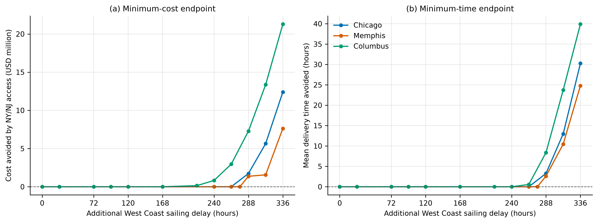
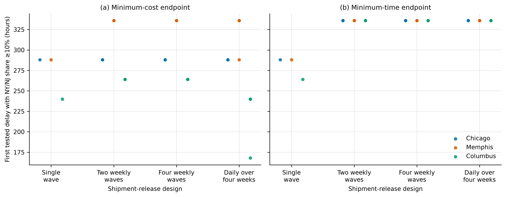
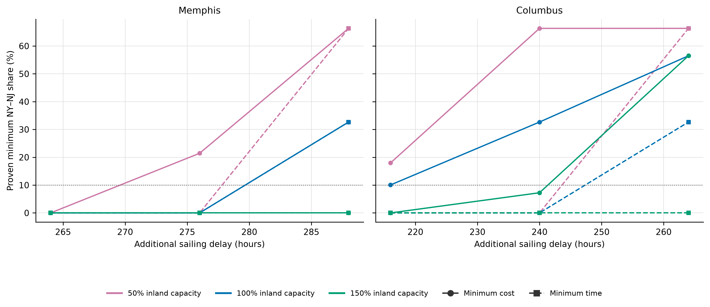
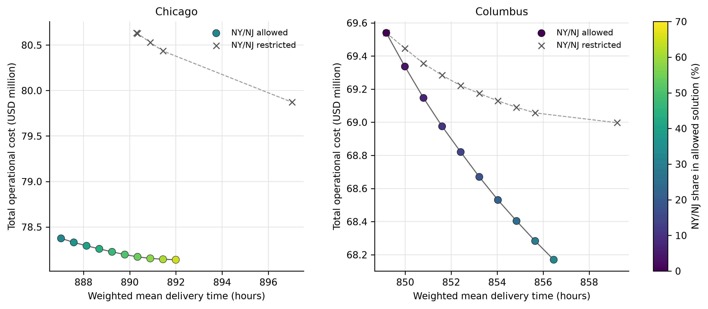

# 7. Results

## 7.1 Exact reference solutions

The final analysis used all simple structural paths satisfying the limits of eight transport legs, four mode changes, and no repeated node. Enumeration produced eight feasible paths for each origin–destination–gateway combination. The model with NY–NJ contained 960 shipment–path variables, while the model without NY–NJ contained 640. For every destination, disruption condition, and gateway-access design, the minimum-cost-then-time and minimum-time-then-cost lexicographic endpoints were solved exactly. All 180 core endpoint models were evaluator-consistent and proven optimal; the maximum relative solver gap was \(9.98\times10^{-9}\). Exactness is conditional on the stated structural paths and on selecting, for each scheduled arc, the earliest departure whose cutoff can still be met after the cargo arrives and completes the required transfer processing.

Table 2 reports the undisturbed reference solutions. NY–NJ was absent from every endpoint-equivalent region: both its proven minimum and maximum shares were zero. The reference solutions were therefore supported entirely by the two West Coast gateways, although the difference between the cost and time endpoints shows a substantial cost–time trade-off.

**Table 2. Exact baseline endpoints under the complete structural path library.**

| Destination | Endpoint | Total cost (USD million) | Weighted mean delivery time (h) | NY–NJ share (%) |
|---|---|---:|---:|---:|
| Chicago | Minimum cost, then time | 22.863 | 668.351 | 0 |
| Chicago | Minimum time, then cost | 29.886 | 602.296 | 0 |
| Memphis | Minimum cost, then time | 22.430 | 687.534 | 0 |
| Memphis | Minimum time, then cost | 29.390 | 600.282 | 0 |
| Columbus | Minimum cost, then time | 23.969 | 700.544 | 0 |
| Columbus | Minimum time, then cost | 31.558 | 609.177 | 0 |

Baseline sensitivity checks produced the same qualitative result. Reducing the NY–NJ ocean cost by as much as 30% or shortening the Panama-route transit time by 48 h did not activate NY–NJ at either endpoint. A 96 h transit-time reduction introduced a 7.16% NY–NJ share only at the Columbus minimum-cost endpoint, below the pre-specified 10% material-use criterion. These tests establish sensitivity to the selected one-factor changes; they are not a calibration to observed market shares.

## 7.2 Gateway capacity, sailing delay, and avoided disruption losses

Reducing the common West Coast gateway-node capacity to 60%, 40%, or 35% of baseline did not introduce NY–NJ at either endpoint for any destination. The compound condition combining 30% remaining gateway-node capacity with 168 h of West Coast sailing delay also produced zero NY–NJ shares. This result was unchanged when total demand at 35% gateway-node capacity was scaled to 80%, 100%, or 120% of baseline. Maximum daily-arc utilisation nevertheless reached 100% in these experiments, and maximum node-day utilisation ranged from 95.24% to 100%. The tested gateway-node reductions were therefore accommodated through other West Coast path and timetable choices; this result does not extend to every type of capacity restriction.

Sailing delay produced a different response. Figure 1 reports the exact value of NY–NJ access over the West Coast delay grid, augmented by the unchanged-capacity observations at 216 h for Columbus and 276 h for Memphis. Panel (a) reports the minimum-cost endpoint and Panel (b) reports the minimum-time endpoint.

**Figure 1.** Exact value of NY–NJ access under additional West Coast sailing delay. Positive values equal the objective without NY–NJ minus the objective with NY–NJ.

Chicago used no NY–NJ through 264 h and used it materially at 288 h at both endpoints. Memphis still used no NY–NJ at 276 h but used it materially at 288 h. Columbus used 10.056% NY–NJ at the minimum-cost endpoint at 216 h, while its minimum-time endpoint remained at zero. At 264 h, both Columbus endpoints used NY–NJ. Accordingly, the tested single-wave brackets are \((264,288]\) h for Chicago, \((276,288]\) h for Memphis, \((168,216]\) h for the Columbus minimum-cost endpoint, and \((240,264]\) h for the Columbus minimum-time endpoint. These brackets identify adjacent tested conditions with different gateway-use states; they do not establish monotonic switching within the untested intervals. The 10.056% Columbus share satisfies the 5% and 10% criteria but not a 20% criterion.

**Table 3. Exact endpoint results at the decisive single-wave delay conditions.**

| Destination | Delay (h) | Endpoint | NY–NJ share (%) | Cost avoided (USD million) | Time avoided (h) |
|---|---:|---|---:|---:|---:|
| Chicago | 264 | Minimum cost, then time | 0 | 0.000 | 0.000 |
| Chicago | 288 | Minimum cost, then time | 64.89 | 1.732 | 5.030 |
| Chicago | 288 | Minimum time, then cost | 32.66 | 2.260 | 3.266 |
| Memphis | 276 | Minimum cost, then time | 0 | 0.000 | 0.000 |
| Memphis | 288 | Minimum cost, then time | 32.66 | 1.370 | 11.311 |
| Memphis | 288 | Minimum time, then cost | 32.66 | 1.966 | 2.613 |
| Columbus | 168 | Minimum cost, then time | 0 | 0.000 | 0.000 |
| Columbus | 216 | Minimum cost, then time | 10.06 | 0.144 | −1.668 |
| Columbus | 216 | Minimum time, then cost | 0 | 0.000 | 0.000 |
| Columbus | 240 | Minimum cost, then time | 32.66 | 0.827 | 2.764 |
| Columbus | 264 | Minimum cost, then time | 56.48 | 2.960 | −1.579 |
| Columbus | 264 | Minimum time, then cost | 32.66 | 2.944 | 0.555 |

**Note:** Cost and time differences are calculated as the solution without NY–NJ minus the solution with NY–NJ. A negative time difference therefore means that the corresponding minimum-cost solution with NY–NJ is slower, even though its primary cost objective is lower.

The proven share ranges at these endpoints were effectively point-valued. For example, Chicago at 288 h fixed the NY–NJ share at 64.89% in the minimum-cost region and 32.66% in the minimum-time region. Memphis at 288 h fixed the aggregate share at 32.66% at both endpoints. Columbus at 216 h fixed the minimum-cost share at 10.056% and the minimum-time share at zero. This identifies the aggregate gateway share; it does not require a unique shipment-level allocation.

The share criterion was also checked at 5%, 10%, and 20% on the common delay grid \(\{0,168,240,264,288,336\}\) h (Supplementary Table S1). All three criteria gave the same first tested level within this common grid: 288 h for both Chicago endpoints and both Memphis endpoints, 240 h for the Columbus minimum-cost endpoint, and 264 h for the Columbus minimum-time endpoint. The supplemental Columbus observation at 216 h met the 5% and 10% criteria but not the 20% criterion.

**Supplementary Table S1. First common-grid delay at which the proven minimum NY–NJ share met each criterion (h).**

| Destination | Endpoint | 5% criterion | 10% criterion | 20% criterion |
|---|---|---:|---:|---:|
| Chicago | Minimum cost, then time | 288 | 288 | 288 |
| Chicago | Minimum time, then cost | 288 | 288 | 288 |
| Memphis | Minimum cost, then time | 288 | 288 | 288 |
| Memphis | Minimum time, then cost | 288 | 288 | 288 |
| Columbus | Minimum cost, then time | 240 | 240 | 240 |
| Columbus | Minimum time, then cost | 264 | 264 | 264 |

For metric \(m\), the recovered fraction of disruption loss was calculated as

\[
R_m(\delta)=\frac{f_{m,R}(\delta)-f_{m,A}(\delta)}
{f_{m,R}(\delta)-f_{m,B}},
\]

where \(B\) is the undisturbed baseline, \(R\) is the disrupted solution without NY–NJ, and \(A\) is the disrupted solution with NY–NJ. A destination's first material-use condition is the first tested delay at which the proven minimum share at either endpoint reached 10%. Table 4 reports the absolute values used in this calculation. Only a positive primary-objective disruption loss above the numerical tolerance was used as a denominator.

**Table 4. Absolute objectives and recovered disruption loss at the first material-use conditions.**

| Destination | Condition | Metric | Baseline | Disrupted without NY–NJ | Disrupted with NY–NJ | Disruption loss | Avoided loss | Recovered (%) |
|---|---:|---|---:|---:|---:|---:|---:|---:|
| Chicago | 288 h | Cost (USD million) | 22.863 | 79.872 | 78.140 | 57.009 | 1.732 | 3.04 |
| Chicago | 288 h | Time (h) | 602.296 | 890.296 | 887.030 | 288.000 | 3.266 | 1.13 |
| Memphis | 288 h | Cost (USD million) | 22.430 | 78.514 | 77.144 | 56.084 | 1.370 | 2.44 |
| Memphis | 288 h | Time (h) | 600.282 | 888.282 | 885.669 | 288.000 | 2.613 | 0.91 |
| Columbus | 216 h | Cost (USD million) | 23.969 | 62.143 | 61.999 | 38.174 | 0.144 | 0.38 |
| Columbus | 216 h | Time (h) | 609.177 | 825.177 | 825.177 | 216.000 | 0.000 | 0.00 |

At 336 h, the corresponding recovery fractions were 17.50%, 10.91%, and 28.46% for cost and 9.00%, 7.37%, and 11.87% for time for Chicago, Memphis, and Columbus, respectively. These values were clearly higher than at the first material-use condition within the tested delay set. A large gateway share nevertheless did not imply that most of the disruption loss had been recovered.

## 7.3 Cost components and sensitivity to penalty rates

The sources of the minimum-cost benefit differed by destination (Table 5). At Chicago 288 h, the USD 1.732 million saving combined lower transport, waiting and holding, and tardiness costs. At Memphis 288 h, NY–NJ increased transport expenditure by USD 1.109 million but reduced waiting and holding cost by USD 0.350 million and tardiness cost by USD 2.129 million. At Columbus 240 h, the USD 0.827 million benefit arose mainly from reductions in tardiness and waiting and holding costs.

**Table 5. Exact minimum-cost saving decomposition (restricted minus allowed, USD million).**

| Destination and delay | Transport | Waiting and holding | Tardiness | Total |
|---|---:|---:|---:|---:|
| Chicago, 288 h | +0.564 | +0.694 | +0.474 | +1.732 |
| Memphis, 288 h | −1.109 | +0.350 | +2.129 | +1.370 |
| Columbus, 240 h | +0.018 | +0.284 | +0.525 | +0.827 |

As the common penalty multiplier increased, tardiness loss evaluated at the original shipment-specific rates decreased monotonically; total tardiness in FEU-hours also decreased in this case. The NY–NJ share itself was non-monotonic. For Memphis at 288 h, it was 10.21% at zero penalty, zero at 25% of the baseline rate, 22.60% at 50%, and 32.66% at the baseline, 150%, and 200% rates. Shipment-level comparison showed that the zero-to-25% change reassigned the four NY–NJ batches to earlier West Coast connections, whereas the 25%-to-50% change reassigned ten batches partly or wholly to NY–NJ. The complete loss sequence and batch identifiers are reported in the supplementary results. Thus, changing the penalty multiplier reordered discrete path and timetable configurations without reversing the monotonic response of the penalised loss. NY–NJ also remained in the three focal minimum-cost solutions when the penalty was zero; these tests used Chicago at 288 h, Memphis at 288 h, and Columbus at 240 h. Changing the holding-cost rate from zero to twice baseline did not change whether NY–NJ was used in those conditions, although it changed the exact value and allocation.

## 7.4 Robustness to shipment-release design and demand intensity

The concentrated single-wave design was used as the concentrated-arrival reference case. The release robustness experiment retained the same shipments, batch quantities, and total demand. For every reassigned shipment, its due time was shifted by the same amount as its release time, preserving its delivery allowance. Five fixed seeds changed only the volume-balanced assignment of shipment batches to the specified release waves. The same West Coast delay was applied throughout each constructed instance.

The common release-design grid was \(\{0,168,240,264,288,336\}\) h; 312 h was not tested. Table 6 and Figure 2 therefore report the first observed material-use level within that common discrete set, rather than a continuous activation threshold. Chicago minimum-cost use reached 10% at 288 h in every release design. Its minimum-time use reached 10% at 288 h in the single-wave design, whereas every multi-wave instance remained below 10% at 288 h and reached the criterion at 336 h. Memphis showed the same 288–336 h change in most multi-wave instances. Columbus was the most sensitive to the temporal distribution of demand.

**Figure 2.** First observed tested delay at which all endpoint-equivalent solutions used at least 10% NY–NJ. Multi-wave points are based on the discrete grid \(\{0,168,240,264,288,336\}\) h.

**Table 6. First observed tested material-use levels under alternative release designs (hours).**

| Destination | Endpoint | Single wave | Two weekly waves | Four weekly waves | Daily over four weeks |
|---|---|---:|---:|---:|---:|
| Chicago | Minimum cost | 288 | 288 (5/5) | 288 (5/5) | 288 (5/5) |
| Chicago | Minimum time | 288 | 336 (5/5) | 336 (5/5) | 336 (5/5) |
| Memphis | Minimum cost | 288 | 336 (5/5) | 336 (5/5) | 288 (1/5); 336 (4/5) |
| Memphis | Minimum time | 288 | 336 (5/5) | 336 (5/5) | 336 (5/5) |
| Columbus | Minimum cost | 240 | 264 (5/5) | 264 (5/5) | 168 (1/5); 240 (4/5) |
| Columbus | Minimum time | 264 | 336 (5/5) | 336 (5/5) | 336 (5/5) |

**Note:** The single-wave Columbus minimum-cost endpoint also reached 10% at the supplemental 216 h observation, which was not part of the common release-design grid; that result is reported in Table 3 and Supplementary Table S1.

The dispersed-release results generated shares ranging from intermediate values to 100%, showing that the repeated 32.66% single-wave allocation was not a universal diversion quantity. Because release timing, temporal concentration, resource competition, and accessible service dates changed together, the supported inference is that gateway use is sensitive to the temporal distribution of demand. The experiment does not separately identify a causal release-phase or demand-dispersion effect.

Demand scaling preserved the principal endpoint asymmetries. At Chicago 288 h, the minimum-cost share was 64.89%, 64.89%, and 61.48% under 80%, 100%, and 120% demand, while the minimum-time share was 15.83%, 32.66%, and 37.41%. Memphis 288 h used 15.83%, 32.66%, and 37.41% at both endpoints. Columbus 240 h used the same respective shares at the minimum-cost endpoint but zero at the minimum-time endpoint. Demand intensity therefore changed the amount of diversion without eliminating destination and objective dependence.

## 7.5 Regional inland-capacity reductions and local bottlenecks

The regional inland-capacity test reduced together all four daily-capacity arcs—rail and road from both Los Angeles–Long Beach and Seattle–Tacoma—serving the selected inland destination. Service-departure capacities and gateway-node capacities were unchanged. All 48 endpoint problems, with and without NY–NJ, were proven optimal, as were the endpoint-equivalent NY–NJ share bounds.

With no additional sailing delay, reducing these regional inland capacities to either 50% or 30% did not introduce NY–NJ at either endpoint for any destination (Table 7). The same was true at 50% inland capacity combined with 168 h of delay. At 30% capacity and 168 h of delay, Chicago and Memphis continued to use no NY–NJ, whereas Columbus used a proven 5.724% at the coincident cost and time endpoints. Allowing NY–NJ in that Columbus condition avoided USD 71,787 of cost and 0.538 h of weighted mean delivery time. The share remained below the pre-specified 10% material-use criterion, but the non-zero value shows that a sufficiently severe regional inland restriction can interact with sailing delay before material activation occurs.

**Table 7. Proven NY–NJ shares under regional West Coast inland-capacity reductions (%; minimum cost; minimum time).**

| West Coast delay (h) | Remaining inland capacity | Chicago | Memphis | Columbus |
|---:|---:|---:|---:|---:|
| 0 | 50% | 0; 0 | 0; 0 | 0; 0 |
| 0 | 30% | 0; 0 | 0; 0 | 0; 0 |
| 168 | 50% | 0; 0 | 0; 0 | 0; 0 |
| 168 | 30% | 0; 0 | 0; 0 | 5.724; 5.724 |

In the Columbus 30%-capacity-plus-168 h condition, the Los Angeles–Long Beach road connection reached its reduced 450 FEU/day limit in periods 29 and 31, and the corresponding rail connection reached its 300 FEU/day limit in period 29. The Seattle–Tacoma road connection also reached 450 FEU/day in periods 30 and 31. The same solution therefore exhibited binding daily capacities on several West Coast inland connections together with a small East Coast allocation. Arc identifiers are reported in the supplementary resource table.

The separate local-bottleneck experiment varied one diagnosed Los Angeles–Long Beach-to-destination daily arc to 50%, 100%, and 150% of baseline. It covered Memphis and Columbus and should be interpreted as a local mechanism test rather than a regional inland-capacity experiment.

**Figure 3.** Exact NY–NJ shares under joint changes in West Coast sailing delay and the diagnosed Los Angeles–Long Beach inland daily-arc capacity. Solid and dashed lines denote the minimum-cost and minimum-time endpoints.

**Table 8. Exact NY–NJ shares under the local inland-capacity interaction (%; minimum cost; minimum time).**

| Destination | Delay (h) | 50% inland capacity | 100% inland capacity | 150% inland capacity |
|---|---:|---:|---:|---:|
| Memphis | 264 | 0; 0 | 0; 0 | 0; 0 |
| Memphis | 276 | 21.44; 0 | 0; 0 | 0; 0 |
| Memphis | 288 | 66.33; 66.33 | 32.66; 32.66 | 0; 0 |
| Columbus | 216 | 17.98; 0 | 10.06; 0 | 0; 0 |
| Columbus | 240 | 66.33; 0 | 32.66; 0 | 7.25; 0 |
| Columbus | 264 | 66.33; 66.33 | 56.48; 32.66 | 56.48; 0 |

At Columbus 216 h and 100% inland capacity, the diagnosed Los Angeles–Long Beach road connection reached its 1,500 FEU/day limit in model period 31. The minimum-cost allocation assigned 1,500 FEU through Los Angeles–Long Beach, 503.5 FEU through Seattle–Tacoma, and 224 FEU through NY–NJ. This is the condition producing the proven 10.056% NY–NJ share. The resource account links the aggregate gateway result to a specific connection and period; its code is provided in the supplementary resource table.

For Memphis, 50% inland capacity introduced NY–NJ at the minimum-cost endpoint at 276 h, while the minimum-time endpoint remained at zero. At 288 h, the same capacity level produced 66.33% NY–NJ at both endpoints; raising capacity to 150% removed NY–NJ completely. Columbus responded differently. At 240 h, raising inland capacity reduced minimum-cost NY–NJ use from 66.33% to 32.66% and then 7.25%, while the minimum-time endpoint remained at zero. At 264 h, the minimum-cost share remained 56.48% at both 100% and 150% capacity, but the minimum-time share fell from 32.66% to zero. Gateway-node capacity and the two inland-capacity designs therefore produced distinct allocation responses. Sailing delay further altered those responses.

## 7.6 Preference-dependent gateway value

Eight internal delivery-time limits were solved exactly between the two allowed endpoints for Chicago at 288 h and Columbus at 240 h. At each limit, cost was minimised and delivery time was used as a lexicographic tie-breaker. The same limit was imposed on the NY–NJ-restricted model.

**Figure 4.** Exact endpoint and ε-constrained solutions. Colour denotes the proven NY–NJ share in the allowed solution; crosses denote feasible restricted solutions at the same delivery-time limit.

For Chicago, the allowed NY–NJ share increased from 32.66% at the minimum-time endpoint to 64.89% at the minimum-cost endpoint. Across the eight internal limits it increased from 36.24% to 61.31%. The restricted model was proven infeasible at the first five limits, from 887.581 to 889.787 h, but the unrestricted core model remained feasible. Thus, NY–NJ access expanded the attainable delivery-time region under these additional performance requirements. At the three internal limits where both models were feasible, allowing NY–NJ reduced minimum cost by USD 2.456, 2.375, and 2.289 million.

For Columbus, the restricted model remained feasible at all eight internal limits. The allowed NY–NJ share increased from 3.63% to 29.03%, crossing 10% between the tested limits of 850.796 and 851.605 h. Cost avoided at the same time limit increased from USD 0.110 million to USD 0.774 million. Together with the zero-share minimum-time endpoint and the 32.66% minimum-cost endpoint, these results show that gateway use varied with the decision-maker’s delivery-time requirement.
