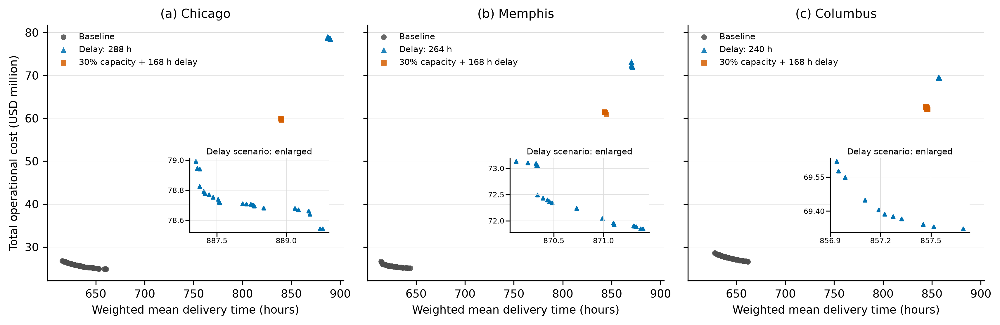
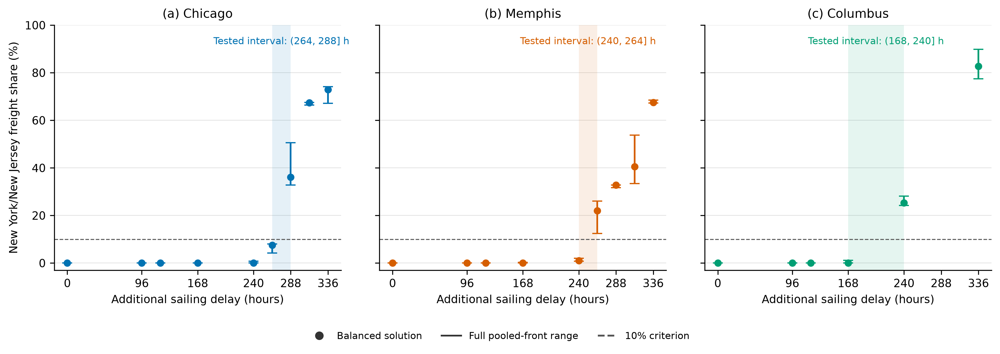
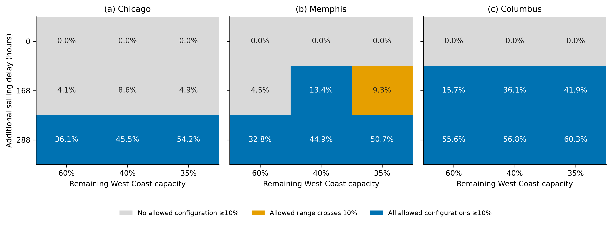
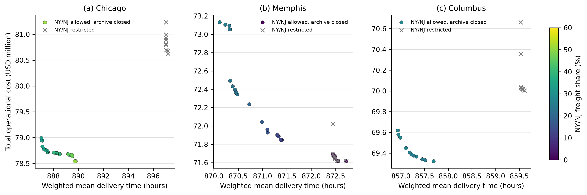
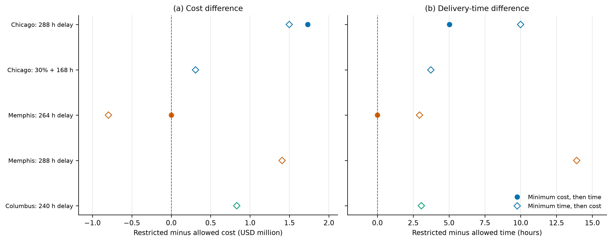
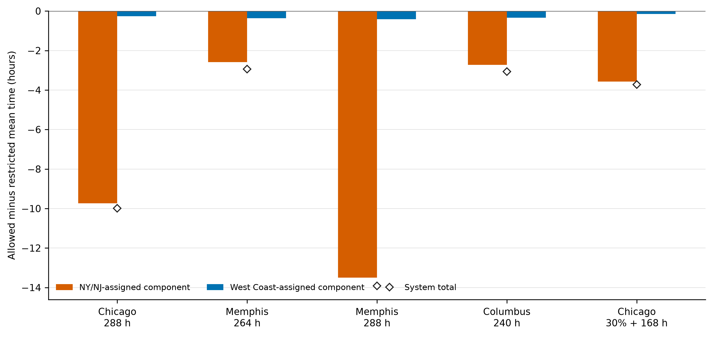

# 7. Results

## 7.1 Computational outcomes and baseline gateway structure

All case–scenario combinations retained for the main analysis produced feasible solutions in each of the 30 independent runs. The pooled baseline archives contained 84 solutions for Chicago, 68 for Memphis, and 71 for Columbus. None routed freight through New York/New Jersey (NY/NJ). The baseline cost–time trade-offs were therefore supported entirely by Los Angeles/Long Beach and Seattle/Tacoma.

Figure 1 compares the baseline archive with the first tested front-wide activation point under delay alone and the compound scenario with 30% remaining West Coast capacity and a delay of 168 h. Both disruption types shifted the attainable solutions towards higher costs and longer delivery times. The plotted points are discrete best-found alternatives under the stated search budget; no continuous frontier is inferred between them.

Figure 1. Cross-seed non-dominated cost and quantity-weighted mean delivery-time solutions. Each point is a routing solution retained after pooling 30 runs. The main axes use common scales across destinations; the inset enlarges the delay-only archive. Baseline and the 30% + 168 h compound case use the v0.7 archive, while the refined delay case uses v0.8 for Chicago and Memphis and v0.7 for Columbus.

## 7.2 Capacity saturation was absorbed within the West Coast system

Capacity-only disruptions did not generate meaningful NY/NJ use. NY/NJ remained absent when regional West Coast capacity was reduced to 70%, 67.5%, 65%, 60%, 40%, or 35% of baseline, and when either West Coast gateway was individually reduced to 50%.

This result cannot be attributed simply to non-binding capacity. Table 2 reports the maximum West Coast node-day utilization in the balanced solution. At 60%, 40%, and 35% remaining capacity, the maximum utilization was between 97.89% and 99.99% across the three destinations, yet the NY/NJ share remained zero. Capacity scarcity therefore altered allocation and timing within the West Coast system without making the longer East Coast route non-dominated.

Table 2. West Coast capacity saturation without NY/NJ activation.

| Destination | Baseline utilization (%) | 60% capacity (%) | 40% capacity (%) | 35% capacity (%) | NY/NJ share in capacity-only scenarios (%) |
| --- | ---: | ---: | ---: | ---: | ---: |
| Chicago | 57.68 | 97.89 | 99.86 | 99.31 | 0 |
| Memphis | 70.21 | 99.99 | 99.40 | 99.79 | 0 |
| Columbus | 66.86 | 99.79 | 99.90 | 99.91 | 0 |

The capacity-days comparison provides a second indication that the response is driven by the relationship between demand and daily capacity rather than by the capacity percentage in isolation. Baseline demand at 40% capacity and 1.25 times demand at 50% capacity both required 0.928 nominal capacity-days. Their balanced Los Angeles/Long Beach shares differed by only 0.09 percentage points for Chicago, 0.09 points for Memphis, and 0.04 points for Columbus; neither condition used NY/NJ. This comparison is not interpreted as a dimensionless load-factor experiment, because demand divided by daily capacity has units of days.

## 7.3 Sailing delay produced destination-asymmetric activation

Regional delays of 96 and 120 h produced no NY/NJ use. At 168 h, Chicago still did not use NY/NJ. Only one of the 11 Memphis archive solutions used it, with a share of 0.28%, while five of eight Columbus solutions used it with shares of 0.37%–1.14%. All three archives therefore remained below the 10% operational criterion.

Longer delays produced discontinuous changes in gateway structure. For Chicago, every solution remained below 10% at 264 h, with NY/NJ shares of 4.22%–8.06%. At 288 h, every solution exceeded the criterion and the range increased to 32.75%–50.56%. The tested front-wide activation interval was therefore \((264,288]\) h.

Memphis activated earlier. Its 240 h archive ranged from 0.80% to 2.03%, whereas every solution in the 264 h archive used NY/NJ for 12.47%–26.04% of freight. The tested interval was \((240,264]\) h. Columbus showed the earliest response: its range was 0%–1.14% at 168 h and 24.17%–28.13% at 240 h, placing the tested interval at \((168,240]\) h.

Table 3. Destination-specific delay activation intervals.

| Destination | Last tested point below front-wide activation | First front-wide activation point | Tested interval |
| --- | --- | --- | --- |
| Chicago | 264 h: 4.22%–8.06% | 288 h: 32.75%–50.56% | \((264,288]\) h |
| Memphis | 240 h: 0.80%–2.03% | 264 h: 12.47%–26.04% | \((240,264]\) h |
| Columbus | 168 h: 0%–1.14% | 240 h: 24.17%–28.13% | \((168,240]\) h |

Figure 2. NY/NJ shares under regional West Coast sailing delays. Dots show the balanced pooled-front solution, and vertical segments show the complete minimum–maximum range across the pooled non-dominated archive, including zero-share solutions. The vertical segments are solution ranges, not confidence intervals. The dashed line is the 10% operational criterion, and the shaded region is the interval between the last tested point below front-wide activation and the first front-wide activation point. No interpolation is made between tested delays.

The destination ordering was therefore Columbus, Memphis, and Chicago from earliest to latest activation. The change was not a gradual proportional response: Chicago moved from a maximum share of 8.06% at 264 h to a minimum share of 32.75% at 288 h. The central empirical finding is consequently a destination-dependent regime change rather than a smooth increase in East Coast use.

## 7.4 Capacity amplified East Coast substitution after delay became material

Figure 3 combines the capacity and delay dimensions. With no added delay, no capacity level activated NY/NJ, even when node-day utilization was nearly 100%. At a delay of 168 h, the response became destination dependent. Chicago remained below the criterion at 60%, 40%, and 35% remaining capacity. Memphis entered front-wide activation at 40%, but its 35% archive crossed the criterion and was therefore classified as a transition regime. Columbus was already in front-wide activation at 60% remaining capacity. At 288 h, all nine destination–capacity combinations were in front-wide activation.

Figure 3. Capacity–delay activation regimes. Grey denotes no meaningful activation, orange denotes a transition regime in which the pooled-front share range crosses 10%, and blue denotes front-wide activation. Cell labels show the NY/NJ share of the balanced solution. Classification uses the full pooled-front range rather than the displayed balanced share.

The additional 30% capacity scenarios clarify but do not make every response monotonic. For Chicago at 168 h, the archive was wholly below 10% at 35% remaining capacity and wholly above 10% at 30%; the tested boundary therefore lay between 30% and 35%. Memphis was front-wide above 10% at 40%, crossed the criterion at 35%, and returned above it at 30%. This pattern is reported as a transition region rather than a single monotonic capacity threshold. Columbus was front-wide at 60% remaining capacity and 168 h, so its compound boundary lies between the undisrupted-capacity case and 60%, but was not further localized.

The compound scenario ranges are reported in Supplementary Figure S1. Together, the results indicate an interaction rather than two interchangeable disruption effects: capacity reduction amplified East Coast substitution after the schedule disruption had made the alternative gateway competitive, whereas capacity reduction alone did not cause cross-coast substitution.

## 7.5 NY/NJ improved the attainable frontier but was not required for feasibility

The counterfactual experiments prohibited NY/NJ under the first delay activation point for each destination and under the 30% + 168 h compound disruption. All allowed and restricted conditions produced feasible solutions in all 30 runs. Access to NY/NJ therefore generated no feasibility gain in the tested instances. Its value was expressed through improvements in the attainable cost–time frontier.

Before comparison, the allowed archive was closed with the matching restricted archive. This step removed the logically inconsistent negative benefits caused by independent heuristic searches while retaining the raw differences for audit. Figure 4 compares the archive-closed allowed front with the restricted front for the three delay activation scenarios. The largest visible cost extension occurred for Chicago, while the Columbus allowed archive extended both the cost and delivery-time endpoints. For Memphis, access to NY/NJ mainly altered the time end of the trade-off rather than the cost endpoint.

Figure 4. NY/NJ-allowed and NY/NJ-restricted fronts at the first delay activation point for each destination. Restricted points are shown as grey crosses. Coloured circles show the archive-closed allowed front, with colour indicating NY/NJ freight share. Archive closure adds the restricted points to the allowed candidate archive before non-dominance filtering, consistent with the nesting of the feasible sets.

Table 4 reports paired endpoint benefits after archive closure. Time benefits were present in 30 of 30 runs for five comparisons and in 29 of 30 runs for the Memphis compound comparison. Mean time benefits ranged from 1.52 to 13.18 h. Cost benefits were more heterogeneous. Chicago under 288 h delay and both Columbus comparisons showed strict improvements in at least 29 runs. In contrast, the Chicago and Memphis compound comparisons improved the cost endpoint in only 14 and 16 runs, respectively, and the Memphis delay comparison did so in seven runs. These latter cost results do not support a claim of consistent cost savings.

Table 4. Archive-closed value of access to NY/NJ.

| Destination | Disruption | Feasible allowed/restricted | Mean cost avoided (%) | Cost-improvement runs | Mean time avoided (h) | Time-improvement runs |
| --- | --- | ---: | ---: | ---: | ---: | ---: |
| Chicago | 288 h delay | 30/30 | 2.756 | 30/30 | 8.83 | 30/30 |
| Chicago | 30% capacity + 168 h | 30/30 | 0.384 | 14/30 | 2.20 | 30/30 |
| Memphis | 264 h delay | 30/30 | 0.067 | 7/30 | 1.52 | 30/30 |
| Memphis | 30% capacity + 168 h | 30/30 | 0.517 | 16/30 | 2.52 | 29/30 |
| Columbus | 240 h delay | 30/30 | 1.099 | 29/30 | 2.18 | 30/30 |
| Columbus | 30% capacity + 168 h | 30/30 | 5.409 | 30/30 | 13.18 | 30/30 |

Figure 5. Mean paired endpoint benefits after archive closure. Horizontal bars are 95% percentile bootstrap intervals based on 10,000 paired resamples; labels give the number of runs with a strict improvement out of 30. Cost benefits are percentages of the restricted endpoint, while delivery-time benefits are in hours. The intervals quantify stochastic-search variability under fixed inputs and are not confidence intervals for real-world demand or disruption uncertainty.

The counterfactual evidence changes the interpretation of resilience. NY/NJ did not make an otherwise infeasible instance feasible, and it did not restore baseline performance. Instead, it broadened the set of attainable performance trade-offs under severe disruption. The benefit was consistently time-oriented across destinations, while cost value depended strongly on destination and disruption type.

## 7.6 Mechanisms behind destination asymmetry

Table 5 and Figure 6 decompose the balanced solution immediately above each destination's delay activation interval. Relative to Los Angeles/Long Beach, NY/NJ added 336 h of ocean transit in all three cases. This was partly offset by 242–288 h less waiting and 25–51 h less US inland transit. The offset was strongest for Columbus because its NY/NJ inland leg was 51.07 h shorter than its Los Angeles/Long Beach inland leg.

Table 5. Gateway-component differences above the delay activation interval, NY/NJ minus Los Angeles/Long Beach.

| Destination | NY/NJ share (%) | Ocean transit (h) | Waiting (h) | US inland transit (h) | Total lead time (h) | Total cost (USD/FEU) |
| --- | ---: | ---: | ---: | ---: | ---: | ---: |
| Chicago | 36.11 | +336.00 | −288.06 | −32.60 | +15.40 | −5,028 |
| Memphis | 22.05 | +336.00 | −265.82 | −25.24 | +44.80 | +1,803 |
| Columbus | 25.29 | +336.00 | −241.97 | −51.07 | +44.45 | −4,772 |

Figure 6. Destination mechanism in the balanced solution above the delay activation interval. Panel (a) reports time-component differences and the resulting total lead-time difference for freight assigned to NY/NJ relative to Los Angeles/Long Beach. Panel (b) reports the total cost difference per FEU. Negative values favour NY/NJ. These are representative-solution decompositions, not inferential averages.

The NY/NJ-assigned freight was not individually faster in these representative solutions: its total lead time remained approximately 15–45 h longer. The system-level delivery-time benefit in Table 4 therefore arose from network reallocation. Assigning part of the demand to the all-water route released West Coast schedule and capacity opportunities for the remaining freight. NY/NJ should consequently not be described simply as a faster route.

The cost mechanism also differed across destinations. NY/NJ was approximately USD 5,028 per FEU cheaper than Los Angeles/Long Beach for Chicago and USD 4,772 cheaper for Columbus, but approximately USD 1,803 more expensive for Memphis. This explains why Memphis activated NY/NJ as a cost–time trade-off while showing little consistent improvement at the minimum-cost endpoint. Columbus combined the largest East Coast inland-time advantage with a strong unit-cost advantage, consistent with its earlier activation and larger compound-scenario benefit.

## 7.7 Scope and principal findings

The results identify three linked asymmetries. First, disruption types were asymmetric: capacity scarcity alone was absorbed through West Coast reallocation even when a node-day constraint approached saturation, whereas prolonged delay induced cross-coast substitution. Second, destination responses were asymmetric: Columbus activated first, followed by Memphis and Chicago. Third, the value of NY/NJ was asymmetric across objectives: time benefits were consistent, while cost benefits depended on inland destination and disruption type.

These conclusions apply to the calibrated network and the tested discrete scenarios. The delay intervals are not universal empirical switching times, and the 30 seeds quantify stochastic-search variation rather than input uncertainty. The activation categories refer to the pooled approximate Pareto archive, not to probabilities of real-world gateway choice. Within those limits, the evidence supports a clear operational conclusion: NY/NJ becomes valuable as a performance-diversification gateway when West Coast schedule disruption is sufficiently prolonged, and capacity scarcity magnifies this role after the delay-driven competitiveness boundary has been crossed.

## Source tables

- `analysis/paper_revised/activation_classification.csv`
- `analysis/paper_revised/capacity_saturation_summary.csv`
- `analysis/paper_revised/counterfactual_value_summary.csv`
- `analysis/paper_revised/counterfactual_front_summary.csv`
- `analysis/paper_revised/destination_mechanism_summary.csv`
- `analysis/paper_revised/activation_threshold_sensitivity.csv`
