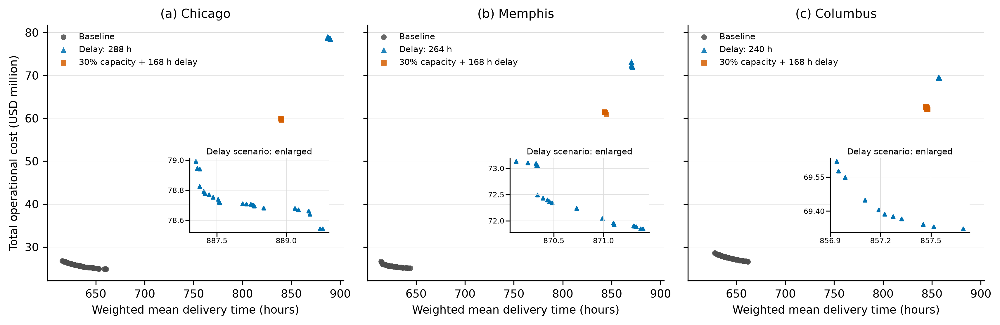
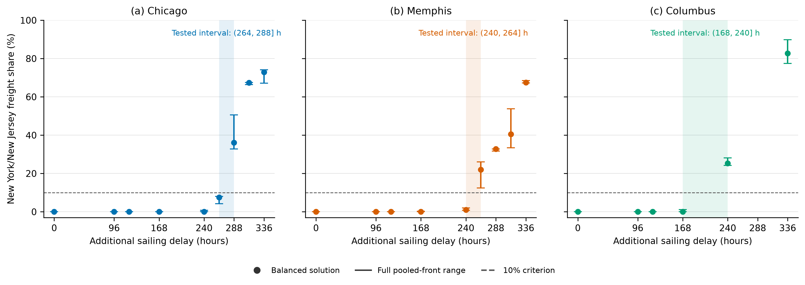
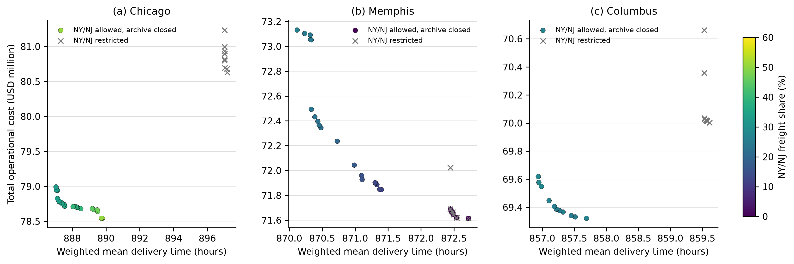
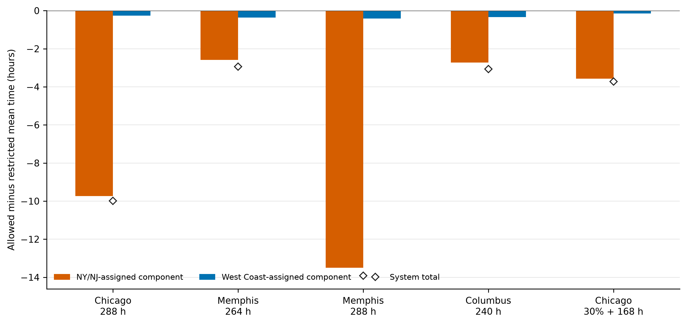

# 7 实验结果

## 7.1 计算结果与基准门户结构

主分析保留的所有案例—场景组合均在30次NSGA-II运行中得到可行解。芝加哥、孟菲斯和哥伦布的基准联合档案分别包含84、68和71个方案，均未使用纽约/新泽西（NY/NJ）；基准成本—时间方案完全由洛杉矶/长滩和西雅图/塔科马承担。

芝加哥基准档案的成本与时间范围为2484万—2677万美元和615.64—660.47小时；孟菲斯为2504万—2664万美元和614.22—644.22小时；哥伦布为2658万—2861万美元和628.06—661.82小时。这些是已保留搜索方案的范围，不是统计区间。另有一项将1.5倍需求与60%剩余西海岸容量结合的诊断没有为任何目的地产生可行种群，因此未纳入激活分析；正文报告的激活实验在原始需求下改变中断条件。

图1将基准搜索档案与统一证据中的当前已知非支配点进行比较。统一证据由启发式结果和已证明的混合整数线性规划（MILP）端点共同筛选而成。芝加哥和孟菲斯采用288小时延误，哥伦布采用240小时延误。精确证据点是离散的，不在两个不同端点之间推断连续前沿。

图1 基准NSGA-II档案与选定延误中断下的当前已知非支配目标点。中断点已经纳入已证明的MILP端点，并排除了随后被证明受支配的历史启发式点。

## 7.2 容量单因素下降由西海岸内部重配吸收

容量单因素中断没有产生具有运营意义的NY/NJ使用。区域西海岸剩余容量降至基准的70%、67.5%、65%、60%、40%或35%，以及任一西海岸门户单独降至50%时，NY/NJ份额均为零。

这一结果不能归因于所有测试容量约束均宽松。表2报告每个场景一个平衡方案中的最大西海岸节点—日期利用率。当剩余容量为60%、40%和35%时，至少一个节点—日期的利用率达到97.89%—99.99%，但NY/NJ份额仍为零。因此，在测试的需求和班次结构下，方案通过西海岸内部的分配与时序调整吸收了容量下降。该诊断并不意味着全部西海岸资源或每个非支配方案都处于饱和状态。

表2 容量单因素场景平衡方案中的最大西海岸节点—日期利用率

| 目的地 | 基准（%） | 60%容量（%） | 40%容量（%） | 35%容量（%） | NY/NJ份额（%） |
| --- | ---: | ---: | ---: | ---: | ---: |
| 芝加哥 | 57.68 | 97.89 | 99.86 | 99.31 | 0 |
| 孟菲斯 | 70.21 | 99.99 | 99.40 | 99.79 | 0 |
| 哥伦布 | 66.86 | 99.79 | 99.90 | 99.91 | 0 |

“容量天数”比较只提供辅助证据，不能用于因果解释。基准需求配40%容量和1.25倍需求配50%容量均需要0.928个名义容量天数。三个目的地下，两者平衡方案的洛杉矶/长滩份额差均小于0.10个百分点，且均未使用NY/NJ。由于其他服务容量没有同比缩放，本文不据此声称“需求除以港口容量”是唯一驱动因素。

## 7.3 精确端点改变了对激活结构的判断

探索性档案中，96小时和120小时区域延误均未产生NY/NJ使用。168小时下，芝加哥仍为零；孟菲斯仅在一个方案中达到0.28%，哥伦布在五个方案中达到0.37%—1.14%，均低于10%的实质性使用判据。因此，首个包含实质性当前已知配置的测试区间分别为：芝加哥264—288小时、孟菲斯240—264小时、哥伦布168—240小时（图2）。这些区间取决于测试网格，不代表普遍现实转换时间。

图2 区域西海岸航次延误下的NY/NJ份额。在四个已验证延误条件上，竖线表示加入精确端点后当前已知非支配配置的份额范围；其他延误点仍为探索性的允许组搜索结果。竖线是配置范围，不是置信区间；虚线为10%的实质性使用判据。

将精确端点并入统一集合后，启发式档案所呈现的结构发生了实质变化。在五个已验证条件中，所有历史启发式点都被至少一个已证明的精确端点支配（表3）。芝加哥288小时和芝加哥复合场景各保留两个不同的精确端点坐标，但两端之间的精确内部前沿没有被枚举。孟菲斯264小时也保留两个坐标：最低成本坐标中的配置均不使用NY/NJ，最短时间坐标使用32.66%。因此，该条件是由目标偏好决定的转换状态。

孟菲斯288小时和哥伦布240小时下，已证明的最低成本与最短时间方案在记录容差内达到相同的目标坐标。因此，在候选路径MILP内，两者的Pareto目标前沿退化为单点。这不等于分配配置唯一：不同配置可能达到相同目标，而全部目标等价配置并未被穷举。两个单点条件下当前找到的两个精确配置都使用32.66%的NY/NJ。

表3 加入精确端点后的统一当前已知非支配证据

| 目的地 | 中断条件 | 被淘汰的启发式点 | 当前已知目标点 | 已保留配置的NY/NJ份额范围（%） | 精确目标空间结论 |
| --- | --- | ---: | ---: | ---: | --- |
| 芝加哥 | 288小时延误 | 24 | 2 | 32.66—64.89 | 精确端点不同，内部未枚举 |
| 孟菲斯 | 264小时延误 | 26 | 2 | 0—32.66 | 目标偏好相关的转换状态 |
| 孟菲斯 | 288小时延误 | 12 | 1 | 32.66 | 容差内已证明的单点目标前沿 |
| 哥伦布 | 240小时延误 | 11 | 1 | 32.66 | 容差内已证明的单点目标前沿 |
| 芝加哥 | 30%容量＋168小时 | 5 | 2 | 19.19 | 精确端点不同，内部未枚举 |

图3直接展示这一证据修正。空心灰点是加入精确解后已不再非支配的历史启发式记录；彩色和黑色标记是已证明的精确端点。尤其是芝加哥复合场景原有的五个闭合点——包括此前用于将该场景分类为“转换状态”的两个零NY/NJ点——均被精确方案支配，不能继续支持旧解释。两个保留的精确复合端点均使用19.19% NY/NJ，但由于精确内部未枚举，本文不据此声称所有Pareto配置都使用NY/NJ。

图3 历史启发式点与已证明的词典序MILP端点。空心灰圆为被淘汰的启发式点；彩色圆点和菱形分别为允许NY/NJ时的精确最低成本端和最短时间端；黑色叉号为禁止NY/NJ的精确端点。孟菲斯288小时和哥伦布240小时下，允许组端点标记重合，表示目标前沿退化为单点。图中不把端点之间的连线解释为已枚举的精确前沿。

因此，统一证据不再支持旧版“所有前沿配置按目的地依次激活”的整齐顺序。能够保留的结论更窄：不同目的地在不同测试延误下首次出现实质性配置，且孟菲斯264小时存在已证明的成本—时间偏好分裂。除非目标前沿本身被证明为单点，正文不再陈述“所有Pareto配置均激活”；即使目标前沿为单点，也不推断配置唯一。

## 7.4 精确反事实端点量化NY/NJ通道价值

允许和禁止NY/NJ的全部反事实模型均可行，因此NY/NJ不是维持测试网络可行性的必要条件。20个端点任务的两个词典序MILP阶段全部得到最优性证明；每个解码分配均与独立评价器以及班次、弧—日期和节点—日期三类容量核算在数值容差内一致。

表4采用“禁止减允许”的口径。正值表示保留NY/NJ通道避免了成本或时间损失；成本负值表示更快的允许组方案需要增加成本。同一行中的成本与时间差来自同一个词典序方案，但不同行端点的收益不保证可由另一个方案同时实现。

表4 候选路径MILP词典序端点上的NY/NJ精确价值

| 目的地 | 中断条件 | 端点 | NY/NJ份额（%） | 禁止减允许成本（百万美元） | 禁止减允许时间（小时） |
| --- | --- | --- | ---: | ---: | ---: |
| 芝加哥 | 288小时延误 | 最低成本，其次时间 | 64.89 | +1.732 | +5.030 |
| 芝加哥 | 288小时延误 | 最短时间，其次成本 | 32.66 | +1.497 | +9.994 |
| 芝加哥 | 30%容量＋168小时 | 最低成本，其次时间 | 19.19 | +0.309 | +3.723 |
| 芝加哥 | 30%容量＋168小时 | 最短时间，其次成本 | 19.19 | +0.309 | +3.723 |
| 孟菲斯 | 264小时延误 | 最低成本，其次时间 | 0 | 0.000 | 0.000 |
| 孟菲斯 | 264小时延误 | 最短时间，其次成本 | 32.66 | -0.797 | +2.939 |
| 孟菲斯 | 288小时延误 | 最低成本，其次时间 | 32.66 | +1.407 | +13.913 |
| 孟菲斯 | 288小时延误 | 最短时间，其次成本 | 32.66 | +1.407 | +13.913 |
| 哥伦布 | 240小时延误 | 最低成本，其次时间 | 32.66 | +0.832 | +3.070 |
| 哥伦布 | 240小时延误 | 最短时间，其次成本 | 32.66 | +0.832 | +3.070 |

孟菲斯264小时是最清楚的偏好相关案例。精确最低成本方案与禁止组达到相同目标坐标且不使用NY/NJ，但本文不假设该坐标上的分配配置唯一；精确最短时间方案将32.66%的货量分配给NY/NJ，将平均交付时间缩短2.939小时，同时增加79.7万美元成本。因此，NY/NJ提供的是“付费换时间”的选项，而不是维持运输或实现最低成本所必需的路径。

孟菲斯288小时和哥伦布240小时下，重合的精确端点相对禁止组同时改善两个目标：孟菲斯分别改善140.7万美元和13.913小时，哥伦布分别改善83.2万美元和3.070小时。芝加哥288小时仍存在真实的精确成本—时间冲突，但允许NY/NJ改善了两个对应反事实端点。芝加哥复合场景也保留两个目标点；两者均使用19.19% NY/NJ，端点避免损失均为30.9万美元和3.723小时。

精确方案同时揭示了启发式档案的局限。在已验证的通道模型中，30个种子得到的最佳NSGA-II主目标与MILP相比，最低成本差距为0.516%—4.338%，最短时间差距低于0.258%。更重要的是，统一支配筛选淘汰了全部定点历史启发式点。因此，启发式结果仅作为探索性搜索证据保留，不再作为这些目标前沿的最终描述。

## 7.5 精确同批次核算识别时效改善机制

本文将每个允许组的精确最短时间方案与相应禁止组精确方案按相同货物批次进行比较。表5采用“允许减禁止”的口径，负值表示改善。NY/NJ构成把允许组中分配给NY/NJ的每份货量与该批次在禁止组中的平均交付时间比较；西海岸构成以相同方式定义。两个构成之和与系统变化完全闭合，最大绝对恒等误差低于 \(1.8\times10^{-13}\) 小时，“其他”构成为零。

表5 精确最短时间反事实的同批次分解，单位：小时

| 目的地 | 中断条件 | 系统变化 | NY/NJ货物构成 | 西海岸货物构成 | NY/NJ货物占时效改善比例（%） |
| --- | --- | ---: | ---: | ---: | ---: |
| 芝加哥 | 288小时延误 | -9.994 | -9.730 | -0.264 | 97.36 |
| 孟菲斯 | 264小时延误 | -2.939 | -2.582 | -0.357 | 87.84 |
| 孟菲斯 | 288小时延误 | -13.913 | -13.501 | -0.412 | 97.04 |
| 哥伦布 | 240小时延误 | -3.070 | -2.727 | -0.343 | 88.83 |
| 芝加哥 | 30%容量＋168小时 | -3.723 | -3.569 | -0.154 | 95.85 |

图4 精确最短时间差的同批次构成。柱形为NY/NJ货物和西海岸货物构成，菱形为系统总变化；负值有利于允许NY/NJ。图中数值是已证明候选路径MILP端点之间的确定性差异，不是现实效应的置信区间。

与此前的启发式解释相反，精确分解没有显示“较慢的NY/NJ货物由西海岸货物的大幅改善抵消”。五组比较中的NY/NJ货物构成均为有利，并贡献系统时效改善的87.84%—97.36%；西海岸货物贡献其余2.64%—12.16%。因此，在精确最短时间方案中，大部分收益直接来自改配至替代门户的货物：与NY/NJ不可用时相同批次的平均结果相比，这些货物获得了更短的交付时间。

班次使用核对与该分配变化一致。四个延误单因素条件均有727.5 FEU从既定上海—洛杉矶/长滩海运班次转移至上海—NY/NJ班次；芝加哥复合条件有427.5 FEU从上海—西雅图/塔科马转至上海—NY/NJ。路径集合发生改变的货物批次数分别为：芝加哥288小时27批、孟菲斯264小时31批、孟菲斯288小时28批、哥伦布240小时28批、芝加哥复合条件15批。这些记录证明了路径与固定班次重配，但不构成拆分货物单位的唯一轨迹，也不能称为内生“缓解拥堵”，因为模型没有港口排队过程。

## 7.6 汇总发现与证据边界

将精确端点与启发式配置纳入同一证据集合后，保留三项主要发现。第一，在测试网络中，容量下降与航次延误产生非对称门户响应：即使节点—日期容量接近约束上限，容量单因素下降仍由西海岸内部重配吸收，而足够长的延误会使跨海岸替代具有竞争力。第二，NY/NJ通道价值同时取决于目的地和目标偏好。孟菲斯264小时体现已证明的“付费换时间”选项；孟菲斯288小时和哥伦布240小时则在容差内由同一目标点同时最小化成本与时间。第三，精确同批次核算表明，最短时间收益主要来自改配至NY/NJ的货物本身，留在西海岸的货物只提供较小的附加改善。

这些结果以构建的案例网络、已生成候选路径和离散测试中断为条件。延误区间不是普遍现实转换阈值；30个种子衡量随机搜索波动，而非输入不确定性。精确性针对候选路径MILP端点成立，不包括候选集中不存在的路径。当两个精确端点不同，内部精确前沿没有被枚举；当端点重合，目标空间前沿在容差内为单点，但配置唯一性仍未证明。因此，正文报告“当前已知配置范围”和“端点特定价值”，不再声称替代门户在全部前沿配置中普遍采用。

## 数据来源表

- `analysis/v13_unified_exact_evidence/unified_nondominated_points.csv`
- `analysis/v13_unified_exact_evidence/displaced_evidence_records.csv`
- `analysis/v13_unified_exact_evidence/unified_classification.csv`
- `analysis/v13_unified_exact_evidence/exact_batch_matched_time_decomposition.csv`
- `analysis/v13_unified_exact_evidence/exact_shipment_time_changes.csv`
- `analysis/v13_unified_exact_evidence/exact_service_departure_quantity_changes.csv`
- `analysis/paper_revised/capacity_saturation_summary.csv`
- `results/v12_exact_endpoint_validation/exact_endpoint_summary.csv`
- `results/v12_exact_endpoint_validation/exact_counterfactual_value.csv`
- `results/v12_exact_endpoint_validation/heuristic_endpoint_quality.csv`
